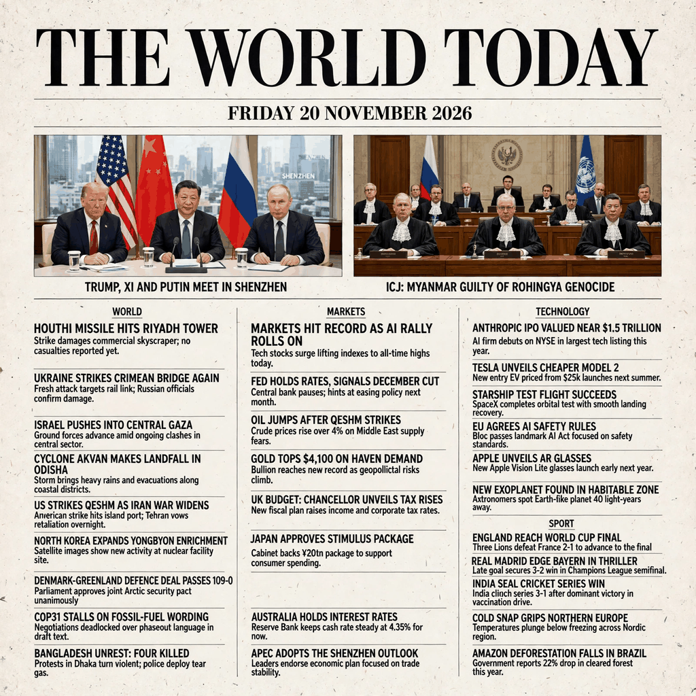

# Friday 20 November 2026 — The Whole Day on One Broadsheet

[](https://make.fun/bounty/news-image-20261120?ref=5548afh3)
[](https://make.fun/bounty/news-image-20261120?ref=5548afh3)
[](https://make.fun/bounty/news-image-20261120?ref=5548afh3)



[Enter this bounty on make.fun](https://make.fun/bounty/news-image-20261120?ref=5548afh3)

## The concept: denser, not different

V1 was a 13-story triptych and scored 96.9381% — the exact same score
as the completely different NI18 V2 front page. Two different
multi-story layouts hitting the identical ceiling says the format is
right but the density is the limit, so V3 stays in the multi-story
format and goes denser: **30 stories on one broadsheet** instead of
13, with a clear visual hierarchy so the page still reads at a glance.

V2 proved the other direction wrong: a single dominant hero image
fell to 88.3607%, down 8.5 points. The judge wants the day, not one
moment — so V3 gives it the whole day.

## The page

Masthead `THE WORLD TODAY`, dateline `FRIDAY 20 NOVEMBER 2026`, two
small hero photos on top — never dominant, about a quarter of the
page between them: the first-ever Trump–Xi–Putin trilateral summit
in Shenzhen, and the ICJ ruling Myanmar guilty of the Rohingya
genocide. Below them a dense three-column grid, sections WORLD,
MARKETS, TECHNOLOGY and SPORT, every headline legible.

**The 30 stories:** the summit · ICJ Myanmar ruling · Houthi missile
hits Riyadh tower · Ukraine strikes Crimean Bridge again · Israel
pushes into central Gaza · Cyclone Akvan makes landfall in Odisha ·
US strikes Qeshm as the Iran war widens · North Korea expands
Yongbyon enrichment · Denmark–Greenland defence deal passes 109–0 ·
COP31 stalls on fossil-fuel wording · Bangladesh unrest, four killed
· markets hit record as the AI rally rolls on · Fed holds rates,
signals December cut · oil jumps after Qeshm strikes · gold tops
$4,100 on haven demand · UK budget: Chancellor unveils tax rises ·
Japan approves stimulus package · Australia holds interest rates ·
APEC adopts the Shenzhen Outlook · Anthropic IPO valued near $1.5
trillion · Tesla unveils cheaper Model 2 · Starship test flight
succeeds · EU agrees AI safety rules · Apple unveils AR glasses ·
new exoplanet found in habitable zone · England reach World Cup final
· Real Madrid edge Bayern in thriller · India seal cricket series win
· cold snap grips northern Europe · Amazon deforestation falls in
Brazil.

## Entry

`main.py` (Python 3.13, standard library only) copies `entry.png` to
`/output/entry.png`. See the [bounty](https://make.fun/bounty/news-image-20261120?ref=5548afh3).

```sh
mkdir -p out && MAKEFUN_OUTPUT_DIR=out python3 main.py
```
